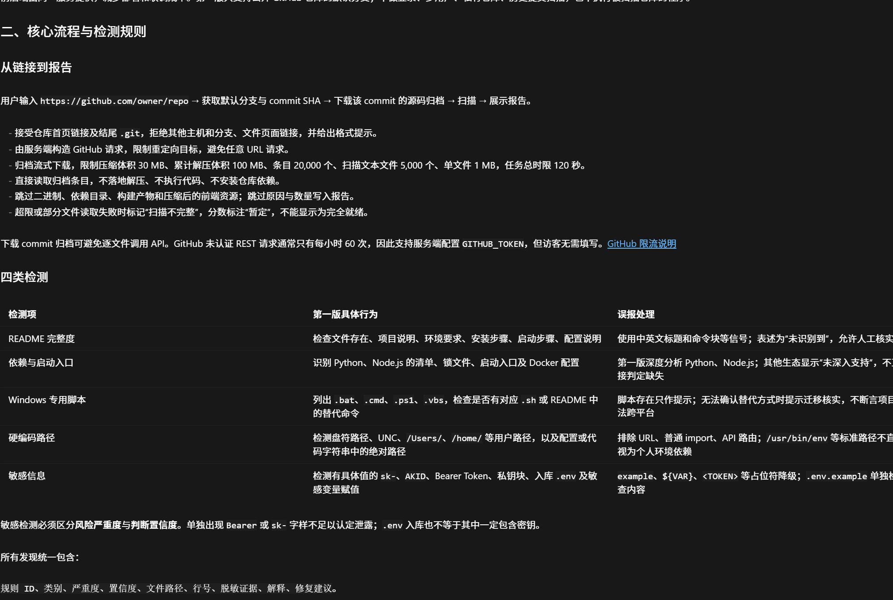
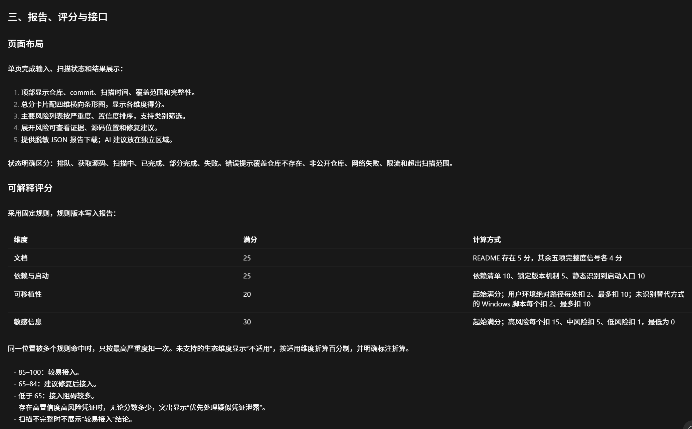
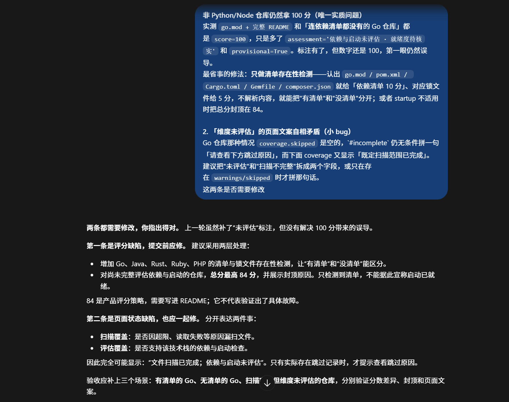

# AI 使用与验证记录

本项目使用 **WorkBuddy 和 OpenAI Codex** 辅助完成“Git 仓库接入体检”。开发过程为：提出需求、生成方案与代码、实测与审查、反馈反例、修复并验证。核心扫描与评分采用确定性规则，AI 建议不参与评分。

## 1. 使用的 AI 工具

| 工具 | 使用说明 |
|---|---|
| WorkBuddy | 开发过程中使用的 AI 辅助工具之一；现有截图未单独展示其操作记录，本文不将无法核实的具体代码或修复归属于它。 |
| OpenAI Codex | 辅助需求拆解、扫描器与 Web 页面实现、测试编写、问题定位、评分修复和文档整理，并执行安装、测试及 Git 操作。 |

开发者负责确定需求、审查实际效果、提出反例和验收标准。AI 的方案和“已完成”结论需要验证，不能直接当作正确性的证据。产品中的可选模型接口与上述开发工具不同，它只基于脱敏结构化发现选择优先处理项。

## 2. Vibe Coding 提示词

以下根据实际需求与交流整理，便于复现思路，不是逐字完整对话；原始交流片段见第 5 节。

### 需求与方案

> 请设计并实现一个 Python Web 工具。输入公开 GitHub 仓库链接后，检查 README、依赖清单、启动入口、Windows 专用脚本、硬编码路径及敏感信息。每项发现要有规则、文件位置、严重度、置信度和修复建议，提供可解释评分及可视化。禁止执行目标仓库代码，敏感信息先脱敏再保存和返回。

### 反例审查

> 请检查 API 路由是否被误判为用户路径，文档路径和测试凭证是否造成过度扣分。用反例验证检测与评分规则，修复后补充回归测试，不要仅为了提高演示项目分数而放宽真实风险检测。

### 继续追问错误修复

> 非 Python/Node 仓库即使没有依赖清单，仍可能得到 100 分。仅增加“未评估”标注不能解决数字误导。请增加其他生态的清单与锁文件存在性检测，未完整评估时总分封顶 84 分，并区分文件扫描覆盖与维度评估覆盖，修正文案矛盾。

### 交付验证

> 在干净克隆和独立虚拟环境中安装依赖并运行测试，验证有清单与无清单的 Go 样本分数不同、未完整评估时不显示完全就绪、页面不要求查看不存在的跳过原因。确认文档与规则版本一致，再提交代码。

## 3. AI 答错但被我发现：未评估的仓库仍获得 100 分

### 初始方案与问题

AI 初版只深入支持 Python 和 Node.js，将其他生态的“依赖与启动”维度视为不适用，从分母中剔除，再折算百分制。这样可能把未知状态表现为满分。

检查并反馈 Go 样本时发现：`go.mod + 完整 README` 和“没有依赖清单、但 README 完整”的 Go 仓库都可能得到 `score=100`。

第一次修改仅加入 `assessment='依赖与启动未评估 · 就绪度待核实'` 与 `provisional=True`，数字仍然是 100。我继续指出：用户第一眼看到的分数依然误导，文字标注没有修复评分逻辑。同时发现文件扫描完整时，页面仍要求查看不存在的“跳过原因”。图 3 记录了问题反馈及 AI 承认上一轮修改不充分的交流。

### 原因与修复

问题根源是将“没有完整评估”当成“不参与评分”，并混用了文件覆盖与评估覆盖的状态。最终修改为：

- 所有仓库始终纳入四个评分维度，以 100 分为分母。
- Go、Java、Rust、Ruby、PHP 增加清单和对应锁文件存在性检测，不声称完成了启动流程分析。
- 清单存在得 10 分，对应锁文件存在得 5 分；未深入评估的启动入口不给该项分数。
- 未完整评估依赖与启动时，总分最高 84 分并说明原因。这是产品策略，不代表验证出了具体故障。
- `coverage.complete` 表示文件扫描覆盖，`assessment_complete` 和 `assessment_notes` 表示维度评估覆盖。仅在实际存在跳过记录时提示查看跳过原因。
- 规则版本升级为 `1.2.0`，修复提交为 `306fdfb`。

### 验证结果

| 样本或场景 | 修复后结果 |
|---|---|
| 完整 README、Go 源文件、无清单 | 75 分，明确标注评估未完整 |
| 相同样本增加 `go.mod` | 依赖维度 10 分，总分 84 分 |
| 再增加 `go.sum` | 依赖维度 15 分，总分仍封顶 84 分 |
| 文件扫描完整、维度未完整评估 | 不要求查看不存在的跳过原因 |
| 支持的生态实际发生漏扫 | 显示文件扫描不完整及实际跳过原因 |

复核代码：`tests/test_scanner.py` 中的 `test_basic_ecosystem_manifest_scores`、`test_supported_assessment_and_file_coverage_independent`，以及 `tests/test_frontend.cjs`。

这次经历说明：AI 声称已修复后，仍需检查输出数字和实际行为，不能只接受解释文字。

## 4. 如何验证其他 AI 输出

- **自动化验证**：在远端仓库的干净克隆和独立 Python 3.12 虚拟环境中安装依赖，57 项 Python 测试通过，前端状态文案测试通过。
- **规则与边界样本**：覆盖凭证占位符、普通 Bearer 说明、类型注解、动态引用、私钥正文隐藏、UTF-16 脚本、URL/包名及 API 路由误报；凭证均为合成测试数据。
- **真实扫描**：扫描过 `pallets/flask`。v1.1.0 校准后，同一 commit 得分为 76，`docs/` 中的真实报告和页面截图保留生成时的规则版本，不冒充 v1.2.0 重扫结果。
- **大仓库**：实际下载 `pinchbench/skill` 的约 47.06 MB 归档，扫描 264 个文本文件。部分超大或无法解码文件被跳过，报告明确标注扫描不完整。
- **页面验证**：开发中检查过筛选、证据展开、固定 commit 源码链接及桌面、移动布局。v1.2.0 状态文案使用 DOM 桩回归测试，不将其等同于浏览器视觉验收。
- **AI 降级**：可选模型接口使用 HTTP Mock 验证正常响应、无效 JSON、未知发现 ID、超时及降级；未把 Mock 结果描述为真实付费模型调用成功。
- **验证限制**：尚未验证真实模型调用和 Docker 构建；启发式规则仍可能误报、漏报，不代表完整安全审计或实际启动验证。

```bash
python -m pip install -r requirements-dev.txt
python -m pytest -q
# 前端检查需要 Node.js，无需安装 npm 依赖
node tests/test_frontend.cjs
```

## 5. Vibe Coding 过程截图

三张图片按过程顺序排列，保留原图。它们是方案及人工纠错交流截图，**不是测试终端截图**。部分初期截图边缘有截断，本文不补写不可见内容。

### 图 1：初期检测流程与规则设计

展示固定 commit 扫描、检测分类、证据定位与误报处理的初期方案。截图中的 30 MB、120 秒为旧版设计；最终限制可配置，默认下载 200 MB、任务时限 300 秒，其他生态也增加了基础清单检测。该图用于记录过程，不是最终参数说明。



### 图 2：初期报告布局与评分设计

展示四维评分、风险清单、脱敏报告及原始折算策略。图中“剔除未支持维度再折算”的方案后来暴露了满分误导问题，低风险凭证扣分也已增加合计 5 分上限。最终规则以 README 和 v1.2.0 实现为准。



### 图 3：人工发现评分缺陷并推动纠正

展示我反馈“非 Python/Node 仓库仍得 100 分”和覆盖文案矛盾，AI 承认上一轮修改不充分，并提出后续修复方案。对应第 3 节“AI 答错但被我发现”的真实记录。


