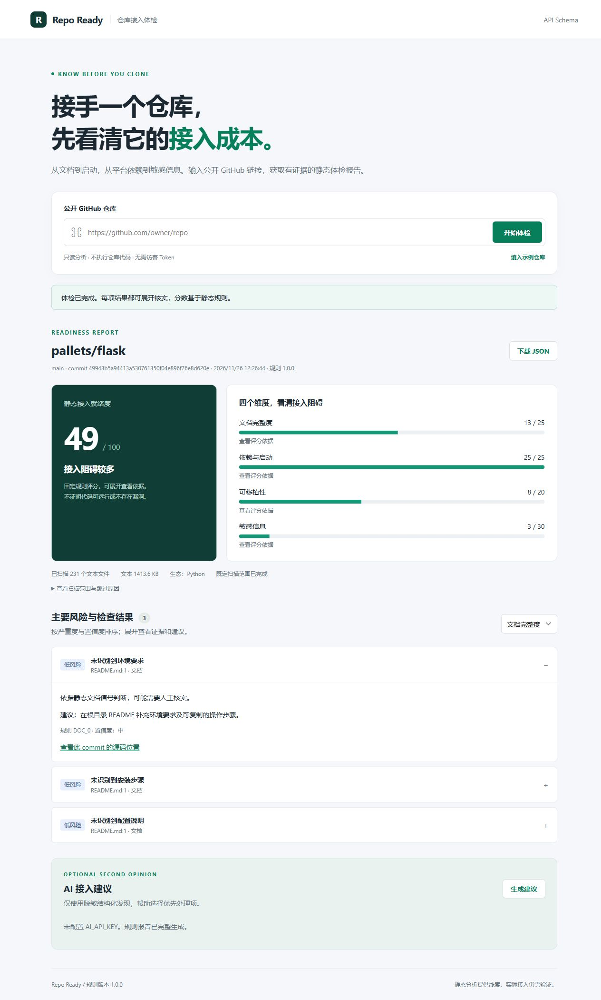

# Repo Ready · Git 仓库接入体检

输入一个公开 GitHub 仓库首页链接，查看文档、依赖与启动、可移植性、敏感信息四个维度的静态体检报告。每条发现带规则、严重度、置信度、文件位置及修复建议，源码链接固定到扫描 commit。

面向「Git 仓库接入体检实战题」实现。核心扫描无需 AI 密钥，无需安装或执行目标项目。



[移动端截图](docs/report-mobile.jpg)

## 快速启动

需要 Python 3.12+，以及到 `api.github.com` 和 `codeload.github.com` 的 HTTPS 连接。

```bash
git clone https://github.com/salk-blip/repo-readiness.git
cd repo-readiness
python -m venv .venv
```

Windows PowerShell：

```powershell
.venv\Scripts\python -m pip install -r requirements.txt
.venv\Scripts\python -m uvicorn app.main:app --host 127.0.0.1 --port 8000
```

macOS / Linux：

```bash
.venv/bin/python -m pip install -r requirements.txt
.venv/bin/python -m uvicorn app.main:app --host 127.0.0.1 --port 8000
```

打开 <http://127.0.0.1:8000>。输入 `https://github.com/pallets/flask` 或你的公开仓库首页；也接受结尾 `.git`。首次扫描会下载固定 commit 的源码，耗时取决于网络和仓库大小。

GitHub 匿名 REST 请求通常每小时仅 60 次，演示前建议设置只用于公开仓库读取的服务端 Token，然后启动服务：

```powershell
$env:GITHUB_TOKEN = "<你的 GitHub Token>"
```

Linux / macOS 使用 `export GITHUB_TOKEN="<你的 GitHub Token>"`。也可复制项目根目录的 `.env.example` 为 `.env`，在本地填写配置。程序启动时自动读取项目根目录 `.env`，已有 shell / 容器环境变量优先（包括空值）；修改后需要重启服务。不要提交真实 Token，`.env` 已被 Git 忽略。

Docker：

```bash
docker build -t repo-readiness .
docker run --rm -p 8000:8000 -e GITHUB_TOKEN repo-readiness
```

默认报告保存在 `data/reports.sqlite3`；可通过 `DATABASE_PATH` 指定路径，容器需挂载可写卷才能在删除容器后保留报告。使用**一个 Uvicorn worker**，后台任务和并发限制均在进程内。最多同时扫描两个仓库，最多容纳 12 个未完成任务。

## 功能与实现

```text
GitHub 首页 URL → 元数据 / 默认分支 → commit SHA
  → 下载该 SHA 的 ZIP → 有界读取文本 → 规则检测 / 脱敏
  → 四维评分 → SQLite 脱敏报告 → 页面 / JSON / 可选 AI 建议
```

- **README**：检查存在、项目说明、环境要求、安装、启动、配置六项信号，支持中英文线索。
- **依赖与启动**：深入识别 Python / Node.js 清单、锁文件、固定版本 requirements、package scripts、Python 入口与 Docker 配置。其他生态做清单与锁文件基础检测，未完整评估时总分封顶 84 分。
- **Windows 脚本**：列出 `.bat` / `.cmd` / `.ps1` / `.vbs`；同目录同名 `.sh` 或 README 跨平台命令视为替代线索，仍需人工确认用途等价。
- **硬编码路径**：个人盘符路径、UNC、`/Users/`、`/home/`；代码字符串里的 `/opt/`、`/srv/` 等绝对路径另作提示。URL、API 路由、`/usr/bin/env` 不直接扣分。
- **敏感信息**：有值的 `sk-`、`AKID`、Bearer、私钥标记、敏感变量赋值、已入库 `.env`。占位符和环境变量引用不按具体凭证扣分；文档、示例和测试中的凭证模式降为低风险，私钥标记保留高风险。
- **报告页面**：四维条形图、风险类别筛选、折叠证据、固定 commit 源码跳转、JSON 下载；刷新带 `?scan=任务ID` 的页面可恢复查看报告。

前端采用原生 HTML/CSS/JS 条形图，无 npm 构建步骤和第三方 CDN 依赖。FastAPI 自动提供 `/openapi.json` 接口描述。

### 评分规则（v1.2.0）

| 维度 | 规则 |
|---|---|
| 文档 25 分 | README 存在 5 分，其余五项各 4 分 |
| 依赖与启动 25 分 | 清单 10、锁定版本机制 5、静态入口 10 |
| 可移植性 20 分 | 文档路径仅提示不扣分；代码中的个人绝对路径每行扣 2、最多扣 10；未识别替代方式的 Windows 脚本每个扣 2、最多扣 10 |
| 敏感信息 30 分 | 高/中/低风险各扣 15/5/1；同一文件行号按最高项去重，低风险合计最多扣 5 分；维度最低 0 |

总分由四维得分相加得到百分制，使用 Python `round` 取整。85–100 为“较易接入”，65–84 为“建议修复后接入”，更低为“接入阻碍较多”。高置信度高风险凭证独立触发醒目告警，不被总分掩盖。扫描不完整时仅显示暂定分数。

**这不是项目质量排名，也不证明代码能运行。** 文档启发式会漏掉外链说明，测试样例可能拉低敏感维度，单仓库多项目当前按仓库整体聚合，不证明每个子项目都具备启动资料。所有疑似泄露都需要核实，工具不调用目标凭证验证有效性。

### 扫描边界

只扫描默认分支的当前 commit，不扫描 Git 历史、子模块、LFS 实体。二进制、依赖目录和构建资源为有意排除范围，不据此称为扫描失败；页面列出排除数量。

| 限制 | 行为 |
|---|---|
| 下载 ZIP 200 MB | 超限失败，提示调整 `SCAN_MAX_DOWNLOAD_MB` |
| 归档条目 100,000 / 累计读取文本 512 MB | 截断并标记不完整 |
| 文本文件 20,000 / 单文件 2 MB | 跳过并标记不完整 |
| 规则发现 2,000 | 停止后续检测并标记不完整 |
| 扫描任务 300 秒 | 超时失败，可调整 `SCAN_TIMEOUT_SECONDS` |

下载 ZIP 超过 8 MB 时自动转入临时文件，完成或失败后关闭清理；不把归档内容解压为磁盘文件。拒绝危险路径和符号链接。排除的二进制、依赖目录不占文本读取预算。支持 UTF-8、带 BOM 的 UTF-16 和 GB18030 文本。后台文本线程超时后不能被 Python 强制中断，因此依赖上述体积与数量限制约束资源；生产环境可进一步使用独立受限工作进程。

可在 `.env` 配置以下限制，保存后重启服务生效；已有 shell 环境变量优先：

```dotenv
SCAN_MAX_DOWNLOAD_MB=200
SCAN_MAX_EXPANDED_MB=512
SCAN_MAX_ENTRIES=100000
SCAN_MAX_FILES=20000
SCAN_MAX_FILE_MB=2
SCAN_TIMEOUT_SECONDS=300
```

配置必须为正整数。支持的最大值依次为 1024 MB、2048 MB、200,000 项、100,000 个、10 MB、1800 秒。大仓库扫描仍会占用文本和发现对象内存，应结合机器资源调整。

SQLite 只保存脱敏报告，不保存原始源码或归档。敏感发现隐藏整个证据行；其他发现的证据也先进行凭证模式替换，私钥块正文不输出。未识别的敏感信息仍可能遗漏，查看 JSON 前应理解这是启发式工具。日志不记录源码、Token 或上游错误正文。

## API 与可选 AI

| 接口 | 行为 |
|---|---|
| `POST /api/scans` | 请求 `{"repository_url":"https://github.com/owner/repo"}`，202 返回 `id` |
| `GET /api/scans/{id}` | 状态、阶段、错误和完成后的报告 |
| `GET /api/scans/{id}/report` | 下载脱敏 JSON |
| `POST /api/scans/{id}/advice` | 生成并缓存可选 AI 优先级建议 |
| `GET /health` | 服务健康检查 |

状态：`queued` → `running` → `complete` / `partial` / `failed`。重启后未完成任务标记失败，可重新提交。无效 URL 返回 422，队列满返回 429，报告未生成返回 409。

可选配置：`AI_API_KEY`、`AI_MODEL`（默认 `gpt-4.1-mini`）、`AI_BASE_URL`（默认 `https://api.openai.com/v1`）。兼容 Chat Completions JSON 输出接口。

AI 只接收前 30 条发现的 ID、类别、严重度、固定规则标题和建议，不发送源码、文件路径或证据。模型选择最多三项处理优先级，建议文本限制在四个固定动作中；未知 ID、自由文本或无效 JSON 被拒绝。**AI 不计算、不更改规则评分。** 未配置密钥、模型失败或超时不影响规则报告。真实模型付费调用未作为核心验收前置条件，响应校验和失败降级通过 MockTransport 测试。

## 更新跟踪设计（未实现）

1. **发现更新**：调度器定期查询默认分支 SHA，使用 ETag 条件请求；用户也可手动刷新。只有目标仓库有管理授权时才配置 webhook，不能假设可以给任意公开仓库安装 webhook。
2. **避免全量重算**：保存上一版本 `path → blob SHA` 清单，以 `blob SHA + 规则版本 + 规则配置` 缓存内容检测结果。新增和修改文件重新扫描；删除文件移除发现；重命名文件重跑路径相关规则并更新源码链接。
3. **重新聚合**：文档、清单、启动入口、脚本对应关系变化后，重新计算仓库级发现与总分。规则版本升级使相关缓存失效。README 等上下文改变时也重算受影响的上下文规则，不能只按文件内容缓存最终结论。
4. **commit 溯源**：报告保存 SHA、分支、扫描时间、规则版本、覆盖范围。下载、文件清单与源码链接都固定到同一 SHA，避免扫描中途分支更新导致混合版本。
5. **失败和限流**：保留上一次成功报告并显示“更新失败，当前为旧 commit”；按 `Retry-After` / `X-RateLimit-Reset` 调度重试，指数退避且设置上限。新报告完整写入后再原子切换当前指针，失败结果不覆盖旧报告。

第一版每次提交会重新扫描；没有后台更新调度器、增量缓存或自动 webhook。当前连接超时 20 秒，网络读取超时 60 秒，元数据 5xx 最多尝试三次；403/429 立即返回可操作提示，避免无意义重试。

参考：[GitHub 限流](https://docs.github.com/en/rest/using-the-rest-api/rate-limits-for-the-rest-api)、[条件请求与退避](https://docs.github.com/en/rest/using-the-rest-api/best-practices-for-using-the-rest-api)。

## 验证与演示

```bash
python -m pip install -r requirements-dev.txt
python -m pytest -q
# 可选前端文案回归检查，需要 Node.js
node tests/test_frontend.cjs
```

测试包括完整项目精确评分、合成风险精确扣分、凭证占位符、私钥正文隔离、URL/包名误报、UTF-16 脚本、归档截断、队列 API 流程、网络失败、重启恢复，以及模型输出校验。所有样本凭证均为合成数据。

2026-11-26 验证记录：独立 Python 3.12 虚拟环境中 **57 项测试通过**；`node --check app/static/app.js` 通过；真实扫描 Flask 的 231 个文本文件，成功生成并导出报告；浏览器已验证筛选、展开证据和无 AI 密钥降级，桌面与窄屏布局无横向溢出，未捕获到页面控制台错误。测试依赖中有 Starlette 对 httpx TestClient 的弃用提示，目前不影响测试通过。

真实集成示例见 [`docs/example-report.json`](docs/example-report.json)，记录了被扫描的 Flask commit 和扫描覆盖范围。结果仅表示本工具的规则输出，不能理解为 Flask 项目存在已确认的泄露。

AI 使用方式、真实错误与修正过程见 [`AI_USAGE.md`](AI_USAGE.md)。部署到公共网络前需要补充访客限流、任务隔离和数据保留策略；当前适合本地或受控环境演示。Docker 配置已提供，未在本机执行 Docker 构建。

### v1.2.0 评估覆盖与评分封顶

Go (`go.mod/go.sum`)、Java (`pom.xml`，Maven 无通用标准锁文件)、Rust (`Cargo.toml/Cargo.lock`)、Ruby (`Gemfile/Gemfile.lock`)、PHP (`composer.json/composer.lock`) 做文件存在性检测，不解析内容。清单 10 分、对应锁文件 5 分；启动入口未深入评估不给该项分数。所有仓库始终以四维 100 分为分母。非完整支持或混合上述生态时总分最高 84 分，这是产品策略，不代表验证出了故障。

`coverage.complete` 仅表示文件扫描范围；新增 `assessment_complete` 和 `assessment_notes` 表示维度评估覆盖。两者任一未完成时 `provisional=true`，页面分别提示原因。旧报告保留原规则版本，重新扫描才应用新规则。

前端状态文案通过 `node tests/test_frontend.cjs` 的 DOM 桩测试验证：文件完整但评估未完整时不出现“跳过原因”，实际漏扫时才显示对应提示。该检查不等同于浏览器视觉验收。当前 Flask 示例报告与截图保留其真实生成的 v1.1.0 标签；v1.2.0 对该受支持 Python 项目的得分规则未变。
